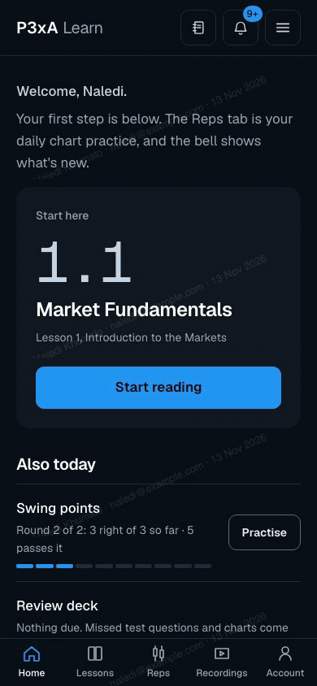
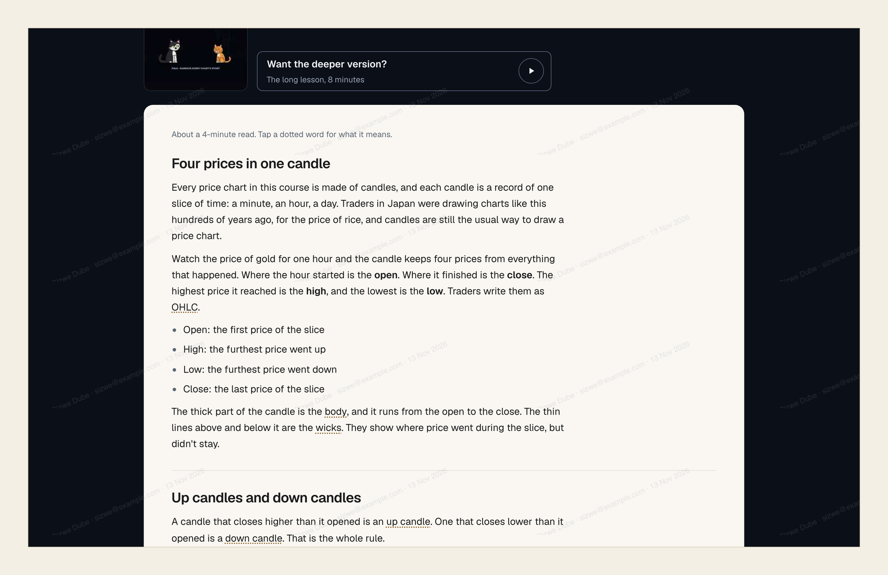
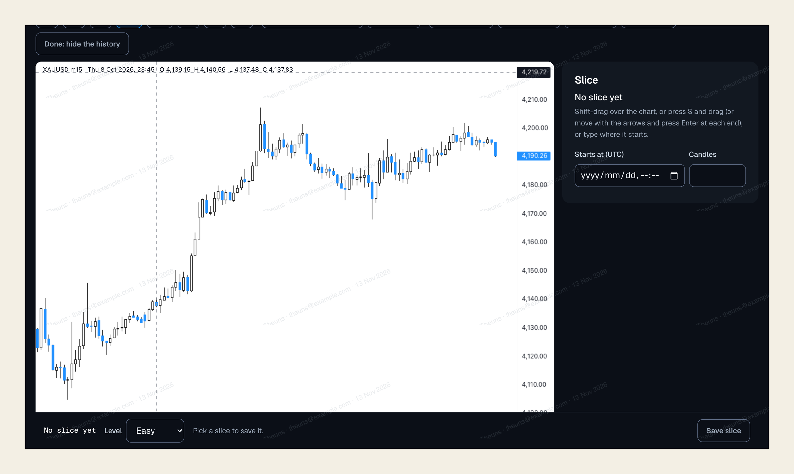
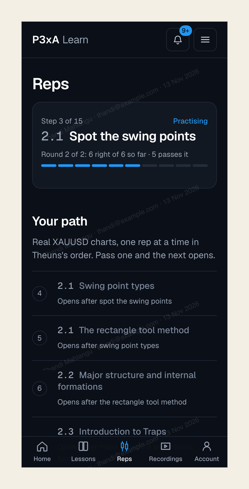
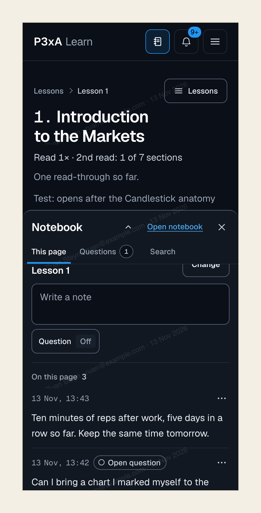
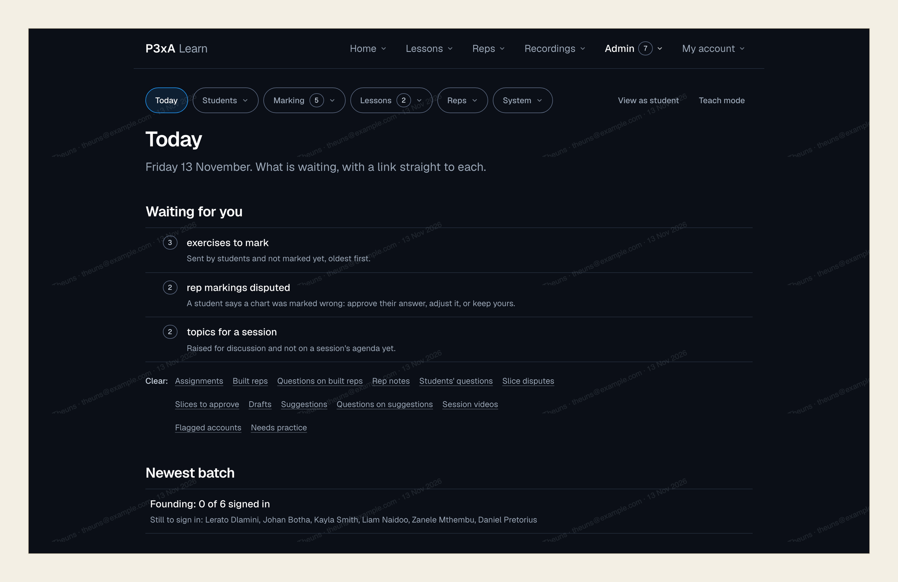
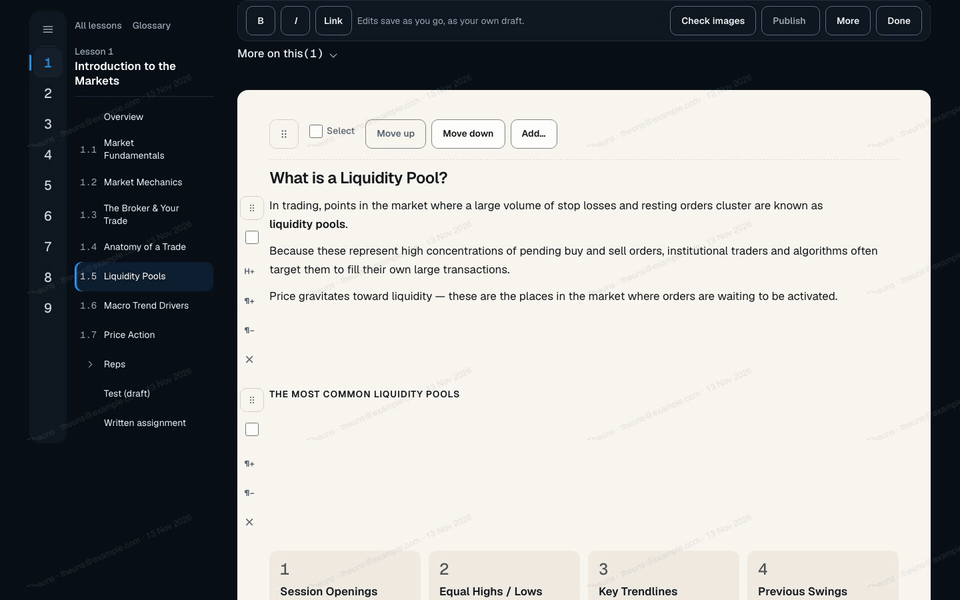
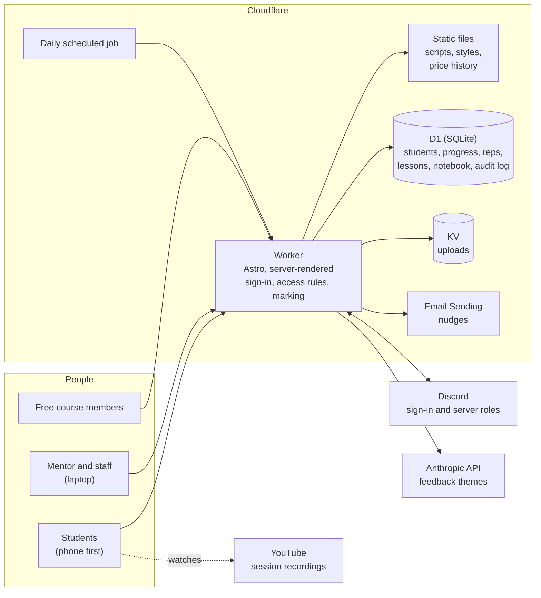

# P3xA Learn

**The student portal for P3xA, a gold price-action mentorship.** Lessons, daily chart practice, a mastery path,
a private notebook and a free public course, with the tools the mentor and staff use to run it all.

**Live:** [learn.p3xa.trade](https://learn.p3xa.trade) · free course: [learn.p3xa.trade/basics](https://learn.p3xa.trade/basics)

> This repository holds no code. The portal's source is private, and the course material inside it (lessons, chart
> practice, tests and their answers) is confidential under the student terms. This page shows what the product does,
> how it is built and what made it hard. Screenshots use sample data: made-up students and a local copy of the portal.

## At a glance

| | |
| --- | --- |
| **Built by** | Theuns Pienaar, the only developer, who also teaches in the mentorship |
| **Timeline** | First commit 16 Oct 2026; the first intake of students started on 2 Nov 2026 |
| **Pace** | About 840 commits in the first four weeks |
| **Size** | About 125,000 lines of TypeScript, Astro and CSS; about 100 page routes; 128 database migrations |
| **Tests** | About 1,900 unit tests, and 60 Playwright browser test files run at phone (390 px) and desktop (1440 px) width |
| **Stack** | Astro 7 on Cloudflare Workers, D1 (SQLite), KV, Better Auth with Discord sign-in, TradingView Lightweight Charts |

## Who it is for

- **Students**, mostly on a phone, often on mobile data, with five to fifteen minutes between the weekly lesson and
  the recap session. They need to know what to do today, read a section, practise the read on a chart with a thumb,
  hand in work and see where they stand.
- **The mentor and staff**, on a laptop in short bursts. They need to see what is waiting (work to mark, disputes,
  questions), check one student's progress before a message, build chart practice, edit lessons and open the next
  lesson for a group of students.

## What it does

### Lessons with read-throughs
Lessons are read on a calm "paper" page, section by section. The portal keeps each student's place and which
sections they have read through, opens lessons on a schedule for each group of students, and lets students download
or print a lesson with their name watermarked on every page.

### Chart reps and the rep builder
A **rep** is one short chart exercise on real gold (XAUUSD) price history: read the chart, mark your answer with
drawing tools that work like TradingView's, get marked at once. The mentor and chosen helpers build reps in the
**rep builder**: pick a moment in minute-by-minute price history, set the question, and the portal's rule
engine works the answer out from the candles before it is saved. The answer stays on the server until the student
has answered.

### The mastery path and proficiency checks
Rep types open one at a time, in the mentor's order. A student passes a type with a run of right answers on
consecutive days; with difficulty levels switched on, they pass a check at each level before moving up. For some
types students then build reps of their own, which the mentor, staff or trusted students review. An approved rep
can join the pool everyone practises on.

### Disputes
When a student believes a rep was marked wrongly, they dispute it with their reasoning. Disputes land in the mentor's
queue. The mentor either upholds the student or keeps the marking with a note. If a chart was disputed before and the marking stood,
the next student sees that note first. A marking-accuracy view shows where reps get overruled.

### The Student Notebook
A private notebook beside every lesson and recording. A note files itself under the section or session it was
written on. Any note can become a question with the student's own possible answers; a question that is still open
after real work can go to the mentor's queue, and the reply comes back into the notebook. Students can save it as a
PDF, keep a backup file, share it with the mentor if they choose, or delete it with seven days to undo.

### Trading basics: a free public course
A free course at [learn.p3xa.trade/basics](https://learn.p3xa.trade/basics) for anyone in the P3xA Discord server,
built from a series of short teaching videos: short lessons, a rep in every lesson, a test at the end of each unit.
The first lesson works signed out as a sample. It shares the portal's shell and sign-in and nothing else: its own
pages, data and access rules, behind a switch the mentor turns from the settings page.

### Admin and staff tools
- **Today:** one page that shows what needs the team, from work to mark to disputes and notebook questions.
- **Students:** each student's state on one page (lessons, reps, tests, fees), with audited overrides.
- **Lesson editor:** chosen people suggest edits in place; nothing reaches students until the mentor reviews and
  publishes, and every version can be restored.
- **Release schedule and groups:** lessons open by group of students on the mentor's calendar.
- **Insights and nudges:** who has gone quiet, with a nudge that can also go by email (with one-click unsubscribe).
- **Settings and switches:** roles, staff, fees and feature switches, each change audited.

## What made it hard

- **Answers that stay hidden.** Answers are worked out and checked on the server; nothing a student could read
  in the browser gives the answer away. A rule engine re-derives every rep's answer from the candles, and the tests
  run it over more than 300 charts.
- **Real price data, rebuilt.** Higher timeframes are built from one-minute bars in UTC buckets, and the tests check
  that a chart rebuilt this way matches the stored data candle for candle.
- **Privacy between students, tested.** An automated test signs in as each kind of user, before every deploy, and
  checks that no page sends anyone another student's data.
- **Access with several moving parts.** Sign-in through Discord, with the P3xA server's roles opening the portal;
  invites, a two-device rule, groups paced through the lessons, fees, a free tier and staff roles, all worked out
  on one request path.
- **Lessons as versioned data.** Lessons live in the database as published versions with drafts, review and restore,
  so a deploy never changes what students read by accident.
- **AI with care.** For the free course, the mentor can ask Claude (Anthropic's API) to summarise what members found
  unclear in a lesson. Names, emails, links and numbers are stripped before anything is sent, and the result is
  checked against a schema before it is kept.
- **Safe to change daily.** Every deploy runs the full test suite against the built Worker first; the database is
  backed up daily and before every migration, with documented restores. Students' data can be exported or
  de-identified on request (POPIA).
- **Phone first and accessible.** Built to WCAG 2.1 AA with 44 px tap targets, and every page is tested at phone and
  desktop width.

## Architecture

## Design

The portal follows P3xA's own brand: navy around the edges, lessons on cream paper, one blue for actions, gold kept
for achievements, and Geist type, with numbers in Geist Mono. Candles match the mentor's own TradingView colours, so
practice looks like the charts students will trade on.

## Want to see it?

I'm happy to walk you through the portal on a call with sample data. Find me at [freerein.dev](https://freerein.dev).

---

P3xA teaches price action. It is education, not financial advice.
